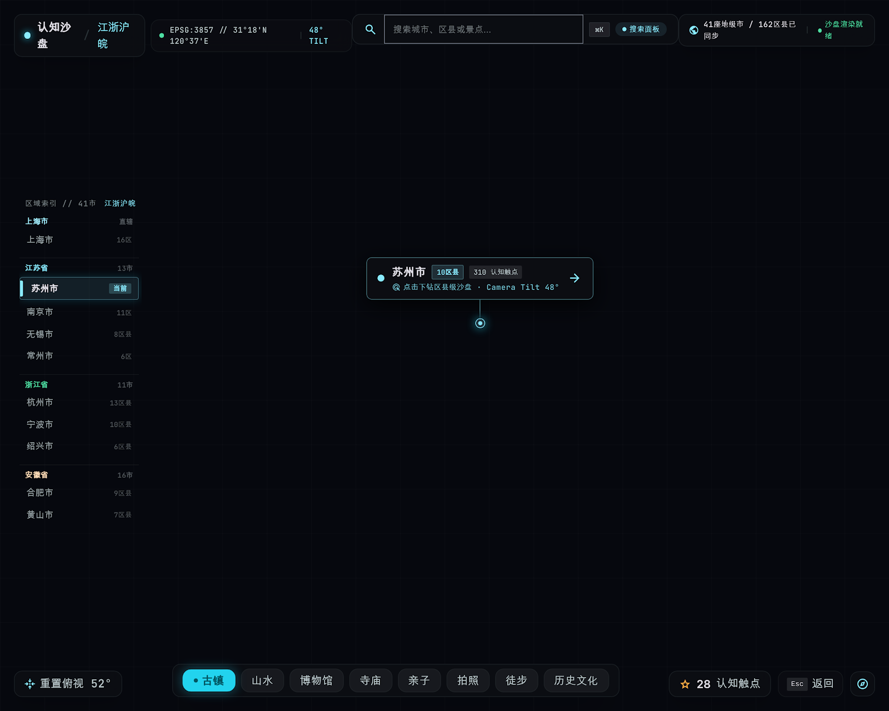

# 山河城邑 · Shanhe Chengyi

> 个人的地方游玩知识库 + 3D 空间索引。以「区 / 县」为最小浏览单元，把零散的历史、人文、美食、景点信息沉淀为本地结构化数据，并用 3D 地图建立空间记忆。



## 功能特性

- **逐级下钻浏览**：区域 → 城市 → 区县 → 景点 / 美食，GeoJSON 挤出的 3D 地块，点击下钻、相机平滑飞抵
- **3D 空间索引**：城市与区县在真实经纬度上挤出成形，透视修正的自动取景，地块永不出画
- **照片墙**：展厅 / 长廊 / 灯箱 / 照片空间四种形态；「照片空间」是所有照片悬浮于夜空中的 3D 球壳，带暖纸色相框，聚焦自动静止
- **图片查看器**：放大 / 缩小 / 旋转 / 平移 / 复位，滚轮锚点缩放、双指捏合、双击切换、键盘翻页
- **本地照片库绑定**：通过 File System Access API 绑定本地目录，按地点自动归类照片与视频；照片字节可缓存进 IndexedDB，离线可用
- **批量上传**：照片墙支持多选上传，归属到具体城市 / 区县，刷新不丢
- **游记**：在城市或区县详情里写图文游记，图片可从已绑定的照片库多选导入，自动关联地点
- **到访记录与时间线**：记录「去过」的时间，时间线面板聚合回顾
- **自定义背景图**：城市、美食、景点均可选一张本地图作背景，localStorage 记索引、IndexedDB 存字节
- **收藏 / 搜索 / 数据面板**：想去清单、Fuse.js 模糊搜索、内容统计
- **移动端适配**：触屏手势、弹框全屏、贴底面板、安全区适配
- **桌面与移动打包**：Tauri 2 套壳，可出 Windows 便携 exe / NSIS 安装器，也支持 Android APK

## 技术栈

| 层 | 选型 |
| --- | --- |
| 框架 | Vite + React 19 + TypeScript（strict） |
| 3D | three.js（命令式，OrbitControls，GeoJSON 挤出 + Raycaster 拾取） |
| 状态 | Zustand（navigation / data / ui / photoLib 等多 store） |
| 套壳 | Tauri 2（Rust 后端 + 内嵌 WebView2，Windows / Android） |
| 持久化 | localStorage（索引与收藏）+ IndexedDB（图片字节） |
| 数据 | 本地 JSON / GeoJSON（`public/content`、`public/geo`），可手动编辑 |

## 快速开始

```bash
npm install
npm run dev        # 开发服务器（默认 http://localhost:5173）
```

```bash
npm run build      # 内容校验 + tsc + vite build，产物在 dist/
npm run preview    # 预览构建产物
```

内容数据有变更时：

```bash
npm run content    # 重建 public/content 派生数据
npm run validate   # 校验内容完整性
```

## 桌面 / 移动打包（Tauri 2）

```bash
npm run tauri:dev            # 桌面调试
npm run tauri:build          # 出 exe（dist 内嵌为单文件）+ NSIS 安装器
npm run tauri:android:build  # 出 APK（需 Android SDK / NDK）
```

Windows 上首次构建需要 MSVC 工具链，可双击仓库根目录的 `install-buildtools.bat` 一键安装。
详细说明见 [`docs/套壳与打包.md`](docs/套壳与打包.md)。

## 本地照片库

设置 → 照片库中绑定一个本地目录（如按地区整理的照片文件夹）：

- 目录内的照片 / 视频按文件名与地点自动归类（横屏 / 竖屏 / 视频 / 动图）
- 支持实时监听目录新增文件
- 未绑定时照片墙回退到内置占位资源，功能不空转

> 照片仅在本地读取，字节可选缓存进 IndexedDB；不上传、不联网。

## 项目结构

```
src/
  app/            启动装配
  components/
    cards/        照片墙、游记、3D 照片空间、数据面板等卡片
    data/         数据面板
    drawer/       区县抽屉
    hud/          HUD 停靠件（城市面板、设置、时间线…）
    shared/       图片查看器、背景图等通用件
  data/           领域类型、照片库索引、IndexedDB 图片存储
  scene/          three.js 场景（构建器、相机、拾取）
  stores/         Zustand 状态
  styles/         全局样式
public/
  content/        城市 / 区县 / 景点 / 美食 JSON
  geo/            GeoJSON 边界
scripts/          内容构建、校验、回归脚本
src-tauri/        Tauri 2 壳（Rust）
docs/             需求 / 设计 / 架构 / 迭代记录
```

## 文档

- [产品需求文档](docs/产品需求文档.md)
- [设计文档](docs/设计文档.md)
- [架构设计](docs/架构设计.md)
- [套壳与打包](docs/套壳与打包.md)
- [迭代记录](docs/迭代记录.md)

## 回归验证

```bash
node scripts/regression-v09.mjs     # v0.9 需求回归（17 项）
node scripts/regression-phaseC.mjs  # 阶段 C 回归（36 项）
node scripts/regression-v10.mjs     # v1.0 需求回归（19 项）
node scripts/diag-v11.mjs           # v1.1 需求诊断（16 项）
```

基于 Playwright + 自研 PNG 像素断言，对视觉与交互改动做实测。

## License

[MIT](LICENSE) © 2026 wuyunjiegithub
