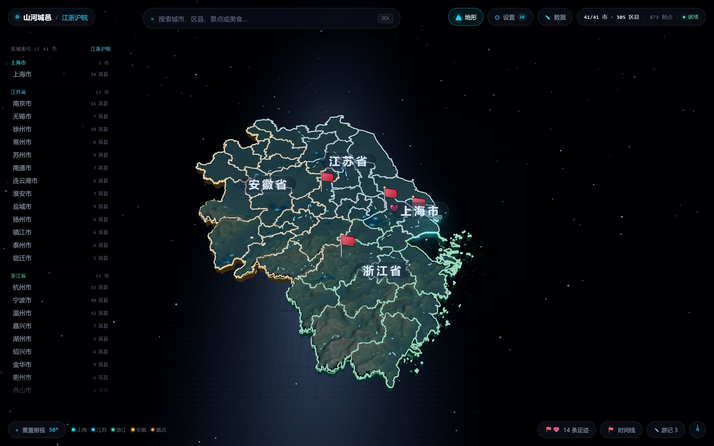

# 山河城邑 · Shanhe Chengyi

以「区 / 县」为最小单位的地方知识库。江浙沪皖的 41 个市、305 个区县、873 个景点的历史、人文、美食与照片，
都锚在真实经纬度的 3D 地形上；游记、足迹、收藏跟着地点走，全部存在本机。



## 界面

| 城市面板 | 区县详情 |
| --- | --- |
|  |  |

| 照片墙 · 展厅 | 照片墙 · 照片空间 |
| --- | --- |
|  |  |

| 游记编辑器 | 足迹与收藏 |
| --- | --- |
|  |  |

| 手机端 · 总览 | 手机端 · 区县 |
| --- | --- |
|  |  |

## 功能

**地图**
- GeoJSON 挤出的 3D 地形，可旋转、缩放、俯仰；区域 → 城市 → 区县逐级下钻，相机平滑飞抵
- 透视修正的自适应取景，当前层级永远完整落在屏内
- 地形 / 天气图层可开关，状态写入本地，下次打开保持上次设置
- 去过的地方插旗（小旗子 / 图钉 / 打卡章 / 脚印四选一），景点以光点标记

**内容**
- 城市与区县详情：一句话印象、诗句、历史、人文、名人、特色、景点、美食、特产与非遗
- 天气：open-meteo 实况 + 未来 7 天；只有真正在下雨下雪的区域才会飘粒子
- 搜索：城市 / 区县 / 景点 / 美食四类，Fuse.js 模糊匹配，最近搜索留痕
- 数据面板：直接在应用内改区县文案，支持导出备份、恢复内置内容

**记录**
- 游记：富文本所见即所得（加粗、标题、引用、列表、对齐、字体、图片改宽），自动保存，图片按原图尺寸插入
- 足迹与收藏：去过 / 想去，地图、面板、时间线三处同步
- 时间线：按到访时间回放，支持手动补录起止日期

**照片**
- 照片墙四种展陈：展厅（网格挂画）、长廊（纵深移步）、灯箱（单幅聚光）、照片空间（3D 星河）
- 桌面端绑定本地目录后按「省 / 市 / 区县」自动归类，支持多选上传、筛选、排序、批量管理
- 手机端直接读系统相册，相册名与区县名对上即自动归类，不需要导入
- 查看器支持缩放、旋转、平移、双击切换；手机端左右滑动切换图片

## 技术栈

| 层 | 选型 |
| --- | --- |
| 框架 | Vite + React 19 + TypeScript（strict） |
| 3D | three.js（命令式场景，OrbitControls，GeoJSON 挤出 + Raycaster 拾取） |
| 状态 | Zustand（navigation / data / ui / photoLib / travelNotes 等） |
| 套壳 | Tauri 2（Rust 后端，Windows / Android 共用一套前端） |
| 持久化 | localStorage（索引、收藏、游记元数据）+ IndexedDB（图片字节） |
| 内容 | 本地 JSON / GeoJSON（`public/content`、`public/geo`） |

## 快速开始

```bash
npm install
npm run dev        # http://localhost:1420
```

```bash
npm run build      # 清理 dist → 重建内容 → 校验 → tsc → vite build
npm run preview    # 预览构建产物
```

内容改动只改来源文件（`scripts/content/*.mjs`），`public/content` 下的 JSON 是生成产物：

```bash
npm run content    # 重新生成 public/content
npm run validate   # 校验内容归属与标签白名单
```

## 打包

桌面端（Windows）：

```bash
npm run tauri:build
```

产出便携版 exe 与 NSIS 安装器。首次构建需要 MSVC 工具链，可双击仓库根目录的 `install-buildtools.bat` 安装。

安卓端（arm64）：

```bash
npm run build            # 先出干净的 dist
npm run android:so       # 带 custom-protocol 编 .so（内嵌前端资源）
npm run android:verify   # 校验资源是否真的内嵌进去了
```

`.so` 拷到 `src-tauri/gen/android/app/src/main/jniLibs/arm64-v8a/` 后用 Gradle 打包。
完整流程、环境变量与踩过的坑见 [`docs/套壳与打包.md`](docs/套壳与打包.md)。

## 本地照片库

桌面端在「设置 → 照片库」绑定一个目录（如 `D:\照片\旅行`）：目录里的照片与视频按文件名和目录结构归到对应地点，
支持实时扫描新增文件；上传的照片写回同一套目录结构。未绑定时照片墙回退到内置占位图，功能不空转。

手机端不绑目录，直接读系统相册：相册叫「西湖区」就出现在西湖区的照片墙里，去掉「市 / 区 / 县」后缀也认。

> 照片只在本机读取，不上传、不联网。桌面端可选把字节缓存进 IndexedDB 以便离线。

## 数据与隐私

游记、足迹、收藏、照片索引都存在本机，没有账号也没有服务器。换设备时用「数据 → 导出备份」带走 JSON，
照片目录手动拷贝即可。

## 目录结构

```
src/
  app/            启动装配、场景编排
  components/
    cards/        照片墙、游记、数据面板等卡片
    data/         内容编辑器
    drawer/       区县抽屉
    hud/          顶栏 / 底栏停靠件（城市面板、设置、时间线、足迹收藏…）
    shared/       图片查看器、标记样式、通用控件
  data/           领域类型、照片库索引、IndexedDB 图片存储
  scene/          three.js 场景（地形、板块、相机、拾取、天气）
  stores/         Zustand 状态
  styles/         全局样式
scripts/          内容构建、校验、打包与回归脚本
public/
  content/        城市 / 区县 / 景点 / 美食 JSON
  geo/            GeoJSON 边界
src-tauri/        Tauri 2 壳（Rust，含安卓相册桥）
docs/             手册 / 需求 / 设计 / 架构 / 迭代记录
```

## 文档

- [用户手册](docs/山河城邑用户手册.md)
- [产品需求文档](docs/产品需求文档.md)
- [设计文档](docs/设计文档.md)
- [架构设计](docs/架构设计.md)
- [套壳与打包](docs/套壳与打包.md)
- [迭代记录](docs/迭代记录.md)

## 回归验证

```bash
node scripts/verify-mobile-ui-v124.mjs    # 手机端照片墙手势 / 风格 / 排序
node scripts/verify-desktop-ui-v124.mjs   # 桌面端对应项未被误伤
node scripts/verify-note-cover-title.mjs  # 游记封面与默认标题
node scripts/verify-editor-toolbar.mjs    # 富文本工具栏固位
node scripts/verify-wall-v19.mjs          # 照片墙瓦片尺寸与懒加载
```

基于 Playwright + Chrome 对视觉与交互改动做实测，脚本都在 `scripts/`。

## License

[MIT](LICENSE) © 2026 wuyunjiegithub
