# 山河城邑 · 用户手册：把每一次旅行装进 3D 地图

## TL;DR

山河城邑是一款**本地优先的旅行记录应用**：用一块可旋转缩放的 3D 地形地图浏览江浙沪皖的省市与区县，把游记、时间线、照片和足迹收藏都锚定在对应的区县上。所有数据只保存在你自己的设备上，不联网、不上传。本手册以桌面端为主、手机端为辅，讲清每一个功能怎么用。

## 你将学到什么

- 在桌面端完成「浏览地图 → 下钻区县 → 记录足迹与游记 → 整理照片」的完整闭环
- 用搜索、索引、图例三种方式快速找到任何一个区县
- 管理本地数据：绑定照片目录、编辑内容、导出备份、恢复内置
- 在手机端用半屏面板、物理返回键和系统相册绑定完成同样的记录

## 适用读者与前置要求

| 项目 | 说明 |
|------|------|
| 适用读者 | 想按「去过哪里」整理旅行记忆的普通用户，无需任何技术基础 |
| 桌面端环境 | Windows 10/11，双击即用，无需安装（独立 exe）；或使用安装包版 |
| 手机端环境 | Android 9 及以上，安装 APK 后授予相册读取权限即可 |
| 前置知识 | 无。会用鼠标拖拽、滚轮，会用手机相册即可 |
| 预计阅读时间 | 10 分钟（可按章节跳读） |

## 数据安全说明

本应用是**单机本地应用**：游记、时间线、收藏、照片索引都保存在你的电脑或手机本地，不经过任何服务器。换设备时可通过「数据 → 导出备份」把内容带走（详见第十章）。

---

## 一、快速开始

### 1.1 桌面端：双击即用

1. 双击 `山河城邑-0.9.5-windows-x64.exe`（独立版，无需安装；也可装 `山河城邑-0.9.5-windows-x64-setup.exe`，文件名随版本变化）。
2. 应用会**自动最大化铺满屏幕**（保留任务栏，可随时点「还原」）。
3. 应用**只允许同时运行一个进程**：已经开着的时候再次双击，不会弹出第二个窗口，而是把已有窗口拉到前台。

> **注意：** 首次启动后如需完整功能，请先按 10.1 节绑定一个照片目录（如 `D:\照片\旅行`），之后上传的照片会自动整理到「省 / 市 / 区县」文件夹中。

### 1.2 手机端：安装后授权相册

1. 安装 `山河城邑-0.9.x-android-arm64.apk`（Android 9+）。
2. 首次启动时会弹一次「允许访问照片和视频」——**请选择允许**（只问一次；不小心拒绝了，
   之后在任意区县的照片墙里点「允许访问系统相册」即可补上）。
3. 授权后，应用会自动把你的**系统相册**与同名区县对上（详见第十一章），不需要任何导入操作。

---

## 二、认识桌面端主界面

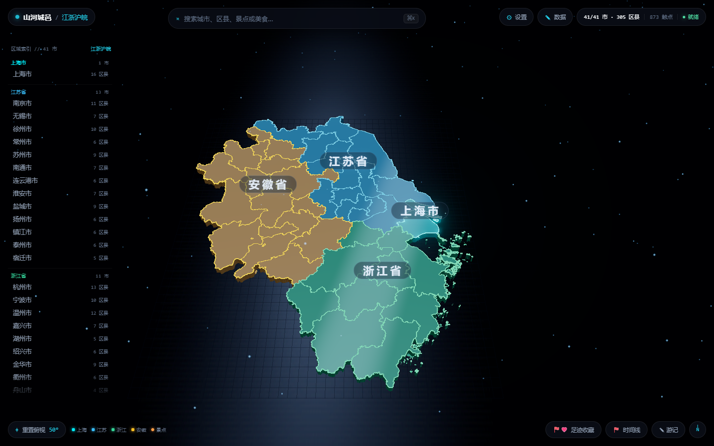

主界面由五部分组成：

| 区域 | 位置 | 作用 |
|------|------|------|
| 省份 / 城市索引 | 左侧竖排列表 | 按「上海市 → 江苏省 → 浙江省」等分组，点击直达对应城市 |
| 3D 地形地图 | 中央主区 | 江浙沪皖地形板块，鼠标拖拽旋转、滚轮缩放 |
| 顶栏 | 顶部 | 品牌与当前层级、搜索框、设置、数据、内容统计 |
| 底栏 | 底部 | 重置视角、足迹收藏、时间线、游记、返回、指南针 |
| 图例 | 左下 | 说明地图上各种标记的含义（去过、收藏、索引、热点） |

地图上的标记含义：**旗标**表示去过或收藏的区县，**光点**表示景点热点。左上角的「重置俯视 50°」和底栏指南针都可以一键回到总览视角。

---

## 三、浏览与下钻：从地图到区县详情

### 3.1 进入城市

在地图上**点击任意城市板块**（如杭州），右侧滑出城市面板：

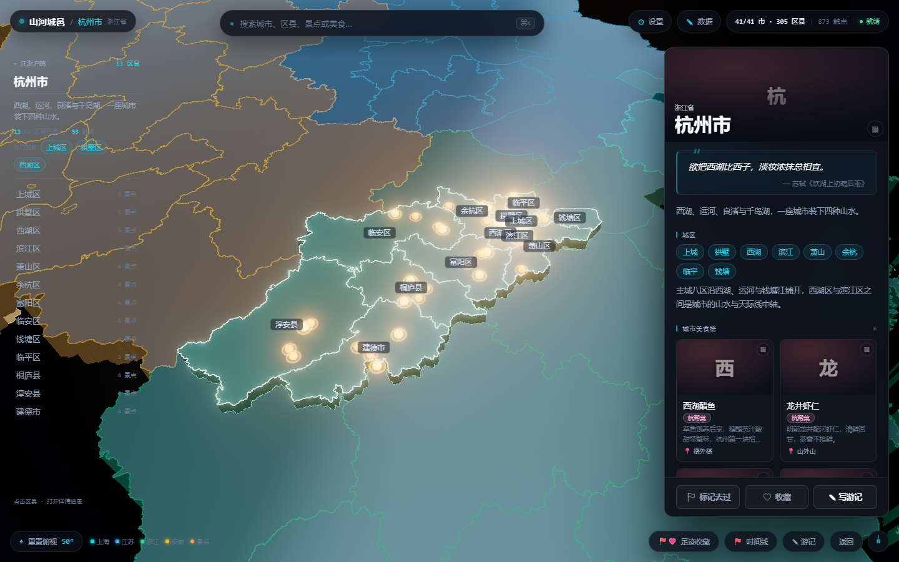

城市面板包含：

- **标题栏**：上一行是所属省份小字，下一行是城市名（名字前常驻 ⚑ 去过、❤ 收藏 两个标记）；
  右上角依次是 ⛶ 全屏（手机端才有）、❤ 收藏、⚑ 去过、× 关闭
- **封面图**：可点击右上角图标更换封面（城市名已移到标题栏，不再压在图上）
- **简介与诗句**：一句话城市印象
- **天气**：「此刻」实况 + 未来 7 天
- **城区 / 城市美食榜**：下辖各区县入口与城市级美食
- **照片墙**：直达该城市的照片管理
- **底部常驻条**：✎ 写游记

### 3.2 打开区县详情

在城市面板中点击任意区县（或在索引 / 搜索中选择），滑出区县详情抽屉：

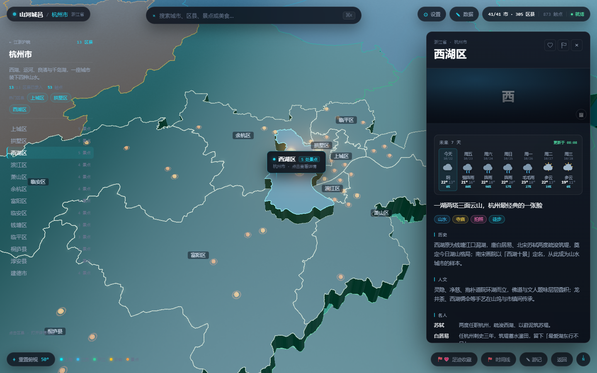

详情页自上而下包含：

1. **区县名与操作**：右上角依次是 ⛶ 全屏（手机端）、❤ 收藏、⚑ 去过、× 关闭
2. **天气**：「此刻」实况 + 未来 7 天（见 3.3 节）
3. **一句话印象**：这个区县最鲜明的标签
4. **历史 / 人文 / 名人 / 特色 / 景点 / 当地美食 / 特产非遗**：可滚动的图文资料卡
5. **照片墙 / 游玩日期**：照片入口与到访日期补录
6. **底部常驻条**：✎ 写游记——常驻吸底，不用滚到底部就能点到

> 城市面板与区县详情共用同一个标题栏组件（`PlaceHeader`）：左边是「省份 / 省 · 市 + 地名（带标记）」，
> 右边固定四颗钮 ⛶ 全屏、❤ 收藏、⚑ 去过、× 关闭，顺序与位置两边一致；写游记同样都在底部常驻条。

### 3.3 天气：此刻与未来 7 天

天气卡片顶部是**「此刻」实况条**：当前天气现象、温度与观测时刻（如「阴 16° 此刻 23:30 实测」），下面是未来 7 天的逐日预报（最高 / 最低温与降水概率）。

数据来自公开的 open-meteo 实时接口，联网时自动刷新：带「此刻」实况的缓存 **30 分钟**更新一次，多日预报 **3 小时**更新一次；离线时读本地缓存。

地图上的 3D 天气图层与这张卡片同源：

- 只有**正在下雨 / 下雪**的区域才会在天上飘粒子，阴天、多云、晴天、雾都不画粒子
- 整层的明暗与雾浓度按「最严重的那类」调（阴雨压暗加雾，晴天提亮）
- 不想要天气图层：顶栏「设置 → 天气图层」可整体关闭

### 3.4 返回与层级

- 点面板右上角 **×**：区县详情 → 收起抽屉（地图保持当前聚焦，不跳回）；城市面板 → **仅收起面板、停留在当前城市视图**（地图不飞回总览），方便继续在地图上点选别的区县。想真正回到江浙沪皖总览，请用顶栏「总览」、底栏「返回」或按 `Esc`。
- 点底栏「返回」或按 `Esc`：区县详情 → 城市面板 → 全省总览，逐层回退
- 点底栏指南针或「重置俯视 50°」：任何时候一键回到总览视角

---

## 四、搜索：三种直达方式

除了在地图上点，还可以用搜索一步到位：

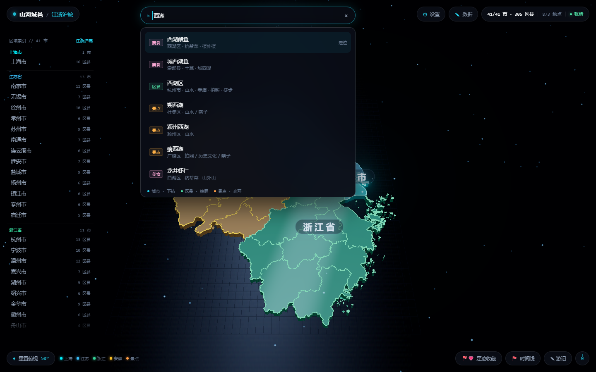

1. 点击顶栏搜索框，或按 `Ctrl + K`（Mac 为 `Command + K`）。
2. 输入关键词，如「西湖」「千岛湖」「东坡肉」。
3. 结果按类型着色：**城市**（下钻）、**区县**（打开详情）、**景点**（地图光环定位）、**美食**（定位到所在区县）。
4. 点击结果或按回车直接跳转；`Esc` 关闭搜索面板。

> **提示：** 最近搜索过的词会以标签形式保留在搜索面板里，方便反复查看。

---

## 五、足迹与收藏

在**城市面板或区县详情的右上角**点 ⚑（去过）或 ❤（收藏）即可标记，再点一次取消：

- ⚑ **去过**：灰色描边为空旗，点亮后是实心小红旗，地图上同步插旗
- ❤ **收藏**：灰色描边为空心，点亮后是粉色实心爱心

名字左侧也会常驻显示这两个小标记，不用进面板就知道有没有标过。

所有足迹集中在底栏左侧的「足迹收藏」总览面板里：按省、市分组，一眼扫完「今年走了多少地方」。地图上的旗标与光点也会实时同步。

---

## 六、时间线

底栏点「时间线」，打开到访时间线：

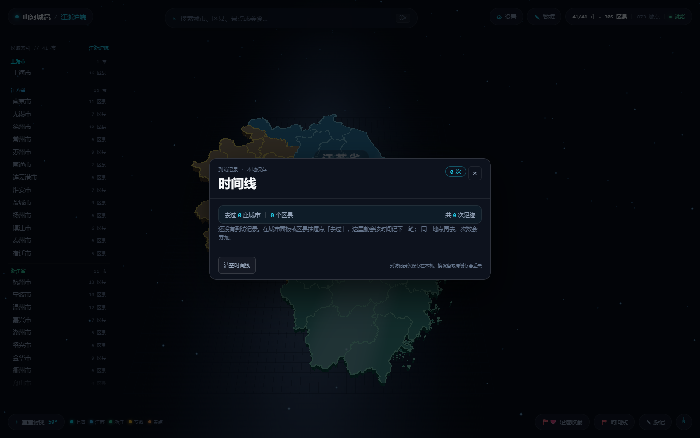

时间线把你**标记过日期**的足迹按时间排成一条线，适合回答「上个五一我在哪」这类问题。日期可以在区县详情里手动补录。

---

## 七、游记

底栏点「游记」，打开我的游记：

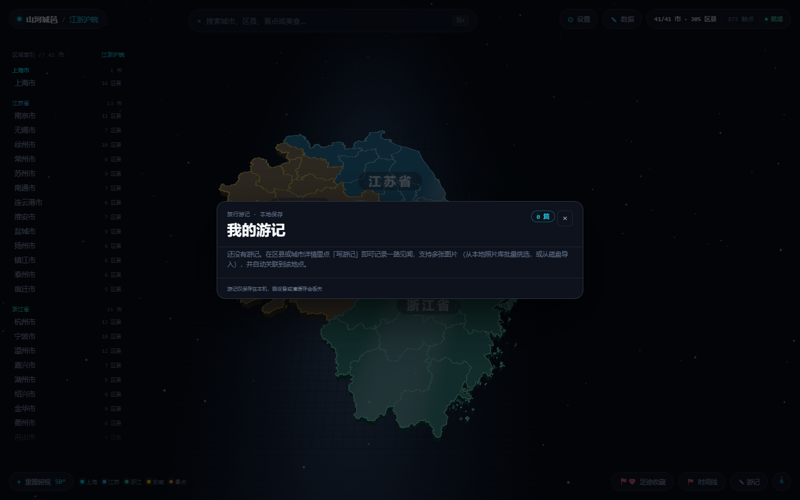

1. 在城市面板或区县详情的**底部常驻条**点「✎ 写游记」，新建一篇并自动关联到该城市 / 区县。
2. **已保存的游记点一下是「预览」不是编辑**：列表里点任意一篇，先用只读方式看最终排版
   （加粗、标题、引用、列表、对齐、字体、图片大小全都和编辑器里一致），要改再点右上角「编辑」进去。
   新建的游记则是直接进入编辑器。
   **右上角操作区从左到右是：`编辑` `删除` `×`（关闭）**，编辑态则是 `保存` `删除` `×`——
   × 始终在最右边。手机上为了给按钮让位，中间那行日期会自动隐藏。
3. 在编辑器里写标题与正文。正文是**富文本所见即所得**——写的时候就是最终排版，不再有「左边输入框、右边预览」两块。
   编辑框是吸顶的浮动面板：手机上键盘弹出时窗口会自动收缩，工具栏始终留在屏幕内、不会被打到上面点不到。
4. 正文上方的工具栏（手机上分两行完整显示）：
   - **B** 加粗、**I** 斜体、**U** 下划线
   - **标题 / 小标题**：把当前段落变成一级 / 二级标题（点第二次取消）
   - **引用**：变成引用块，适合摘句、碑文
   - **• 列表 / 1. 列表**：项目符号 / 编号列表
   - **对齐**（四条横线的四枚图标钮，从左到右）：**左对齐 / 居中 / 右对齐 / 两端对齐**。
     光标停在哪个段落就对齐哪段；点选图片后点对齐，图片会跟着居左 / 居中 / 居右
   - **字体**：下拉切换正文字体——默认字体、宋体、黑体、微软雅黑、楷体、仿宋、隶书、幼圆，
     以及 Arial / Times New Roman / Georgia / Verdana / Courier New。选中文字后切换即生效，
     下拉框会显示光标处当前的字体
   - **＋ 图片**：从**本地照片库**挑选（见第八章），勾选后点「插入（N）」
5. 图片直接落在**正文光标所在处**（没碰过正文就加到末尾），一篇最多 9 张。
   图片按**原图尺寸**插入（原图比正文宽才缩到正文宽），高度自动按比例跟随，不会变形。
   **想改大小**：点一下图片进入选中态（青色描边），拖**右下角的圆形手柄**左右移动即可
   放大 / 缩小（高度始终按比例）；拖到满意松手，尺寸随游记一起保存，下次打开还在。
   点图片右上角的圆形 **×** 删除那张（正文对应位置同步移除）。
6. 编辑器底部显示「图片 N / 9」。保存后回到这篇的预览；预览里可再次「编辑」或删除。
   **删除游记**在右上角操作区（`编辑` 与 `×` 之间），不在正文底部，正文多长都不用往下翻找。
   点第一下按钮变红显示「确认删除」，再点一下才真删，防止误触。

> **注意：** 游记在编辑过程中会自动保存，随时取消都不会丢内容。
> 老版本写的纯文本游记会自动转成富文本打开，无需迁移；正文里旧的 `{{图:…}}` 占位也会自动变成图片。

---

## 八、照片墙

在城市面板或区县详情点「照片墙」，进入照片管理。照片墙提供四种展示样式，右上角一键切换：

| 样式 | 效果 |
|------|------|
| 展厅 | 展墙网格：均匀挂画 + 展签，默认样式 |
| 长廊 | 纵深走廊：两侧挂画，适合横屏照片 |
| 灯箱 | 大幅幻灯：一张一张细看 |
| 照片空间 · 3D | 所有照片汇成旋臂星河，可环绕飞行 |

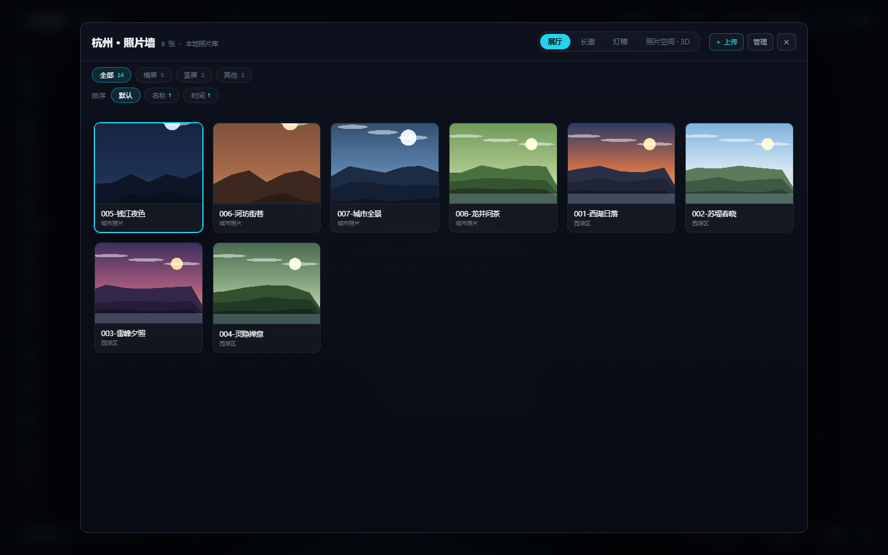

### 8.1 上传照片

1. 点照片墙右上角「+ 上传」。
2. 选择图片或视频（支持 jpg / png / webp / gif / mp4 / webm / mov）。
3. 桌面端：照片自动写入绑定的照片目录下对应的「省 / 市 / 区县」文件夹，并入库。
4. 手机端：不需要上传——在系统相册里整理即可（见 11.4 节）。

### 8.2 筛选、排序与管理

- **筛选**：按画幅（横屏 / 竖屏 / 其他）过滤，快速找到适合当前版式的照片
- **排序**：默认、按名称、按时间
- **管理**：点「管理」进入批量模式，多选后删除；**删除有二次确认**（第一下按钮变红，第二下才真删），防止误触

> **手机端（APK）只做预览**：不显示「+ 上传」「管理」、改名与删除，图片风格、筛选、排序、查看器的缩放 / 旋转 / 平移都保留。照片请直接在手机系统相册里整理，应用按「省 / 市 / 区县」目录自动归类。

---

## 九、照片空间 · 3D：把照片变成一条星河

在照片墙右上角切换到「照片空间 · 3D」，所有照片会飞入一条缓慢自转的旋臂星河中：

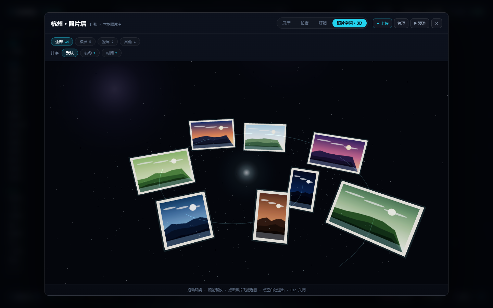

| 操作 | 效果 |
|------|------|
| 鼠标拖拽 | 环绕星河旋转视角 |
| 滚轮 | 拉近 / 拉远 |
| 点击任意照片 | 相机飞抵到照片前 |
| 照片上再点一次 | 放大查看（可缩放、旋转、平移） |
| `Esc` | 退出放大，再按一次退出 3D 空间 |

> **提示：** 3D 空间一次最多铺 200 张照片，超出部分请在展厅或长廊样式中查看。

---

## 十、数据管理

### 10.1 设置：照片库

顶栏点「设置」，进入照片库配置：

- **选择文件夹**：绑定一个本地目录（如 `D:\照片\旅行`）。绑定后上传的照片都归档到该目录下的「省 / 市 / 区县」文件夹
- **实时更新**：开启后，照片目录里每 20 秒自动扫描一次，新丢进去的照片会出现在照片墙里（带 LIVE 标记）
- 绑定信息保存在本机；换目录可随时「重新绑定」

### 10.2 数据面板：编辑、备份与恢复

顶栏点「数据」，打开内容管理面板：

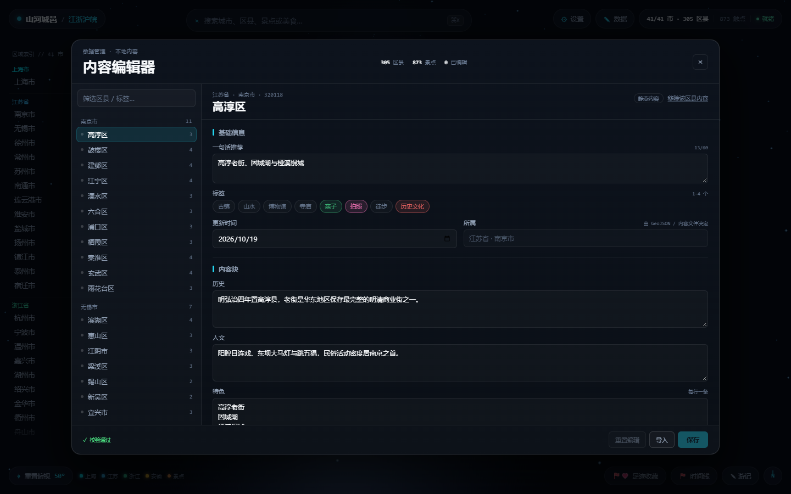

| 操作 | 说明 |
|------|------|
| 编辑内容 | 修改区县的简介、历史、人文、名人、当地美食等文字资料 |
| 保存 | 把修改保存到本机（仅改动部分被保存） |
| 导出备份 | 导出为 JSON 文件，可用于换设备或分享给朋友 |
| 恢复内置内容 | 放弃所有改动，还原为出厂自带的区县资料 |
| 清除修改 | 只清掉自己改过的内容，保留导入的部分 |

> **建议：** 每次大改之后做一次「导出备份」，JSON 文件就是你的完整旅行数据。

**选要编辑的市区县：** 面板左侧（手机端为顶部下拉）是市 / 区县列表，按城市分组。点城市名进入该城市级编辑，点区县行进入区县编辑；搜索框可按区县名 / 标签筛选。**手机端列表默认收起**，只显示一条「选择内容 · 当前名称 ▾」，点开才展开（限高可滚动、可搜索），选完自动收起——把整屏高度留给编辑区。

---

## 十一、手机端使用（辅助说明）

手机端与桌面端**数据逻辑完全一致**，差异只在交互适配。下图是手机端三个典型状态：

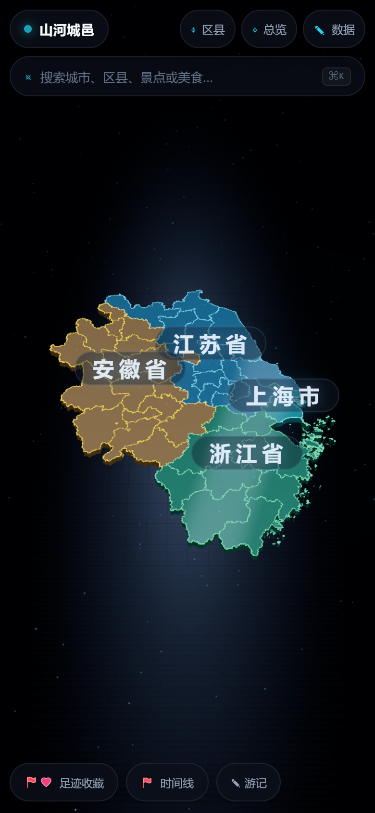

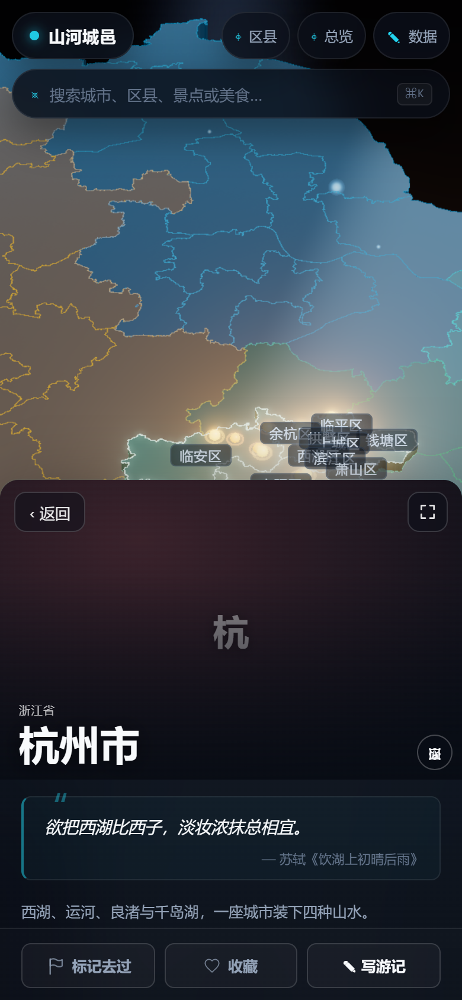

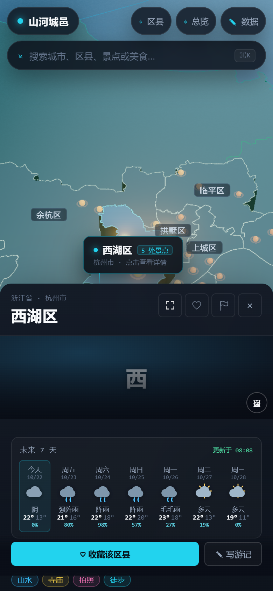

### 11.1 面板默认半屏，可滑下看完整地图，可一键全屏

手机上一打开详情**默认约占下半屏（约 60%，比半屏略多）**，上半屏始终留着地图，可以一边看详情一边点别的区县；选中的市 / 区县会自动框到屏幕上半部分，不会被面板盖住。

- **滑下看地图**：面板顶部有一条横条抓手。点一下抓手，或在抓手上**向下拖**，面板会缩成只剩顶栏的一小条，背后整张地图露出来；再点一下 / 向上拖就展开。这个「收起」**不会关闭面板**，地图视角保持当前聚焦，不会跳回全局总览——想彻底退出再点右上角 ×。
- **一键全屏**：想看沉浸式内容时，点面板右上角的**展开按钮**铺满全屏；再点一次（或按返回键）回到半屏。

### 11.2 物理返回键：逐层关闭，连按两次退出

按手机的返回键时：

1. 全屏面板 → 先退回半屏
2. 半屏面板 → 关闭面板
3. 搜索 / 选择器等浮层 → 关闭浮层
4. 城市层级 → 返回总览
5. 已经在总览 → **2 秒内连按两次返回键才退出应用**（第一次会提示「再按一次退出」）

### 11.3 区县选择器

顶栏点「选择城市 / 区县」，弹出全屏列表：搜索框 + 按城市分组的区县清单，点一下直达，不用在地图上逐个点。

### 11.4 相册自动绑定：不用导入，在相册里整理即可

手机端的照片逻辑与桌面端**完全不同**，这是刻意为之：

- 你在**系统相册**里怎么归置照片，App 就怎么显示
- App 自动把**同名相册**匹配到同名区县：相册叫「西湖区」，就自动出现在西湖区的照片墙里
- 相册叫「淳安」「杭州」这种去掉市县后缀的也能认；市名相册（「杭州市」）归到城市层级
- 授权一次，长期有效：首次启动会弹一次系统相册权限；之后新拍的照片过几秒就进来
- 切回 App 会自动重扫一次；**改了相册名、新建同名相册后**，点照片墙右上角的 **⟳ 刷新相册** 按钮立即重新识别

因此手机上**没有导入按钮，也不需要选目录**——新建相册、把照片拖进去，就是在给山河城邑整理照片。

没授权或某个区县还没有照片时，照片墙里会显示一张说明卡：告诉你「建一个叫这个区县名字的相册」，
并列出你手机里已有的相册和张数，授权按钮也在同一张卡上。

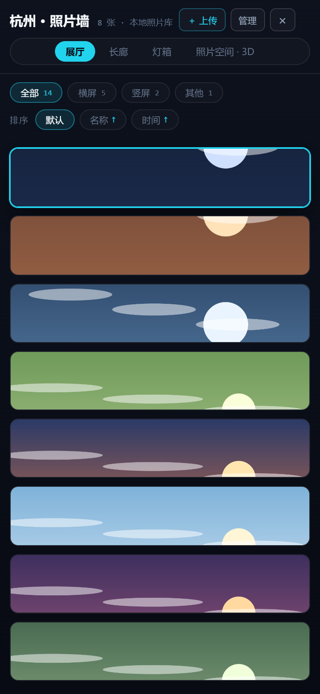

### 11.5 其他手机端差异

- 没有「设置」按钮（照片库逻辑由相册绑定取代）
- 顶栏有「⌖ 总览」按钮，随时一键回到完整地图视角
- 数据面板只保留「保存」与「导出」，不提供导入
- 地图边界线更细、地面网格更疏，保证小屏幕上区县色块依然清晰

---

## 十二、常见问题（FAQ）

**Q1：我的数据存在哪？会上传吗？**
全部保存在本机：桌面端在应用数据目录，手机端在应用私有空间 + 系统相册。不联网、不上传。

**Q2：换了新电脑 / 新手机，数据怎么迁移？**
桌面端：「数据 → 导出备份」得到 JSON，在新设备上「数据 → 恢复」导入即可。照片需手动拷贝照片目录。手机端：照片本来就在系统相册里，重装 App 后重新授权即可自动匹配。

**Q3：为什么双击 exe 没有反应？**
应用已经在运行了。单实例设计下，再次双击只会把已有窗口拉到前台，这是正常行为。

**Q4：手机端照片墙是空的？**
先确认三件事：① 系统相册里存在与区县同名的相册（如「西湖区」）；② 已授予相册读取权限（设置 → 应用 → 权限 → 照片和视频 → 允许）；③ 相册里确实有照片。都满足后进入对应区县即可看到。

**Q5：两个区县同名（如杭州与南昌都有「西湖区」），照片会串吗？**
匹配顺序为「区县名」优先、「市 + 区县名」补充；仍冲突时取第一个并在界面标注来源，不会静默混在一起。

**Q6：删除照片会进回收站吗？**
照片墙里的删除是**真实删除**本地文件，因此设置了二次确认（按钮变红后需再点一次）。删除前请确认。

**Q7：3D 照片空间很卡怎么办？**
3D 场景对 GPU 有要求。可减少该区县的照片数量，或退到「展厅 / 长廊」样式浏览。

**Q8：想改区县资料里的一段话，改错了怎么恢复？**
「数据 → 恢复内置内容」可一键还原全部内置资料；「清除修改」只清自己改过的部分。

**Q9：外面是阴天，地图上怎么还在下雨 / 下雪？**
天气图层只在**当前确实降水**的区域画粒子，数据源是 open-meteo 的「此刻」观测码（不是当天的天气概况），可在城市 / 区县详情的天气卡顶部核对「此刻」实况。若仍不符，多为网络不通读到了本地缓存（卡片右上角会标「离线」）；不需要天气图层可在「设置 → 天气图层」关闭。

**Q10：游记里选了照片却加不进去？**
入口是正文工具栏上的「＋ 图片」（本地照片库）。勾选后点「插入（N）」，或直接双击某一张。
照片会插到**正文光标所在处**，插完正文里立刻就能看到图（所见即所得，没有单独的预览区）。
照片按原图尺寸插入，想要更大 / 更小就点一下图片，拖右下角的圆形手柄。
想让图片居左 / 居中 / 居右，先点一下图片，再点工具栏上的对齐图标钮。
若照片库还没绑定目录，先在「设置 → 照片库」绑定，再点「重新扫描」。

---

## 十三、操作速查表

| 操作 | 桌面端 | 手机端 |
|------|--------|--------|
| 旋转地图 | 鼠标拖拽 | 单指拖拽 |
| 缩放 | 滚轮 | 双指捏合 |
| 下钻城市 / 打开区县 | 点击板块 / 索引项 / 搜索结果 | 点击板块，或用区县选择器 |
| 搜索 | `Ctrl/Command + K` | 顶栏搜索框 |
| 关闭当前面板 | `Esc` | 物理返回键 |
| 回到总览视角 | 底栏指南针 / 「重置俯视 50°」 | 顶栏「⌖ 总览」 |
| 面板全屏切换 | 不需要（桌面端右侧栏不遮地图） | 面板右上角 ⛶ |
| 退出应用 | 关闭窗口 | 总览状态下连按两次返回键 |
| 标记去过 / 收藏 | 面板右上角 ⚑ / ❤ | 同左 |
| 写游记 | 面板底部「✎ 写游记」 | 同左 |
| 上传照片 | 照片墙「+ 上传」 | 不需要（相册自动绑定） |

---

## 元信息

- 适用版本：山河城邑 0.9.5（Windows x64 / Android arm64）
- 数据范围：江苏省、浙江省、上海市、安徽省（41 市 / 305 区县 / 873 个景点触点，持续补充）
- 反馈渠道：GitHub 仓库 `wuyunjiegithub/shanhe-chengyi` 提交 Issue
