# 山河城邑 用户手册

山河城邑是一个单机应用：地图、内容、游记、足迹、照片索引都在你自己的设备上，不联网、不上传。
本手册按功能分区，桌面端（Windows）为主线，手机端（Android）的差异集中在第十一章。

---

## 一、安装与启动

### 桌面端

- **便携版** `山河城邑-x.y.z-windows-x64.exe`：双击即用，不写注册表，可以放在 U 盘里带走。
- **安装版** `山河城邑-x.y.z-windows-x64-setup.exe`：装到本机，有开始菜单快捷方式和卸载入口。

启动后窗口自动最大化（保留任务栏）。应用是单实例的：已经开着的时候再双击一次，只会把已有窗口拉到前台，不会开第二个。

### 手机端

1. 安装 `山河城邑-x.y.z-android-arm64.apk`（Android 9 及以上，arm64）。
2. 首次启动会请求「照片和视频」权限，允许一次即可。误点了拒绝，之后在任意区县的照片墙里点「允许访问系统相册」也能补上。

手机端不需要导入照片，也不需要选目录——直接在系统相册里建一个和区县同名的相册就行（见 11.4）。

---

## 二、主界面

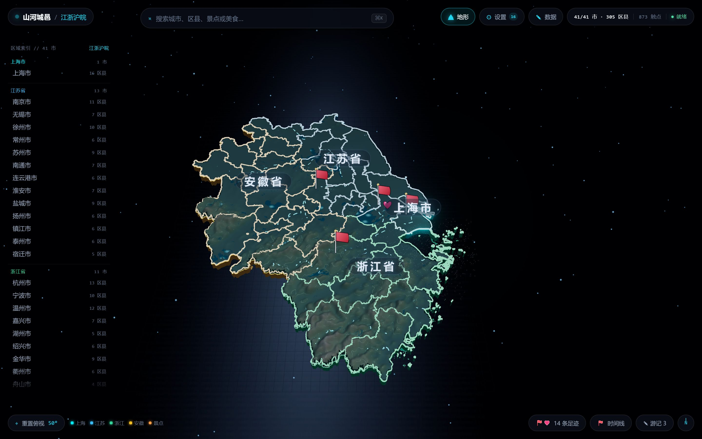

| 区域 | 位置 | 用途 |
| --- | --- | --- |
| 省 / 市索引 | 左侧竖列 | 按省分组列出全部城市，点一下直达 |
| 3D 地形地图 | 中央 | 江浙沪皖的地形与区县色块，可旋转、缩放、俯仰 |
| 顶栏 | 顶部 | 品牌与当前层级、搜索、地形开关、设置、数据、内容统计 |
| 底栏 | 底部 | 重置俯视、图例、足迹收藏、时间线、游记、返回、指南针 |
| 图例 | 左下 | 说明地图上各类标记 |

地图上的标记：**旗子**是去过或收藏的地点，**光点**是景点，鼠标悬停有名字。

手机端顶栏不同：左侧是品牌，右侧是「区县」「地形」「总览」「数据」四个按钮——手机上没有「设置」，照片库改用系统相册（见 11.5）。

---

## 三、地图操作与下钻

### 旋转与缩放

- 桌面：按住左键拖动旋转，滚轮缩放，右键拖动平移。
- 手机：单指拖动旋转，双指捏合缩放。

底栏指南针或左上角「重置俯视 50°」随时回到总览视角。

### 逐级下钻

区域总览 → 城市 → 区县，三层。

1. **点城市板块**（或左侧索引里的城市名），滑出城市面板：

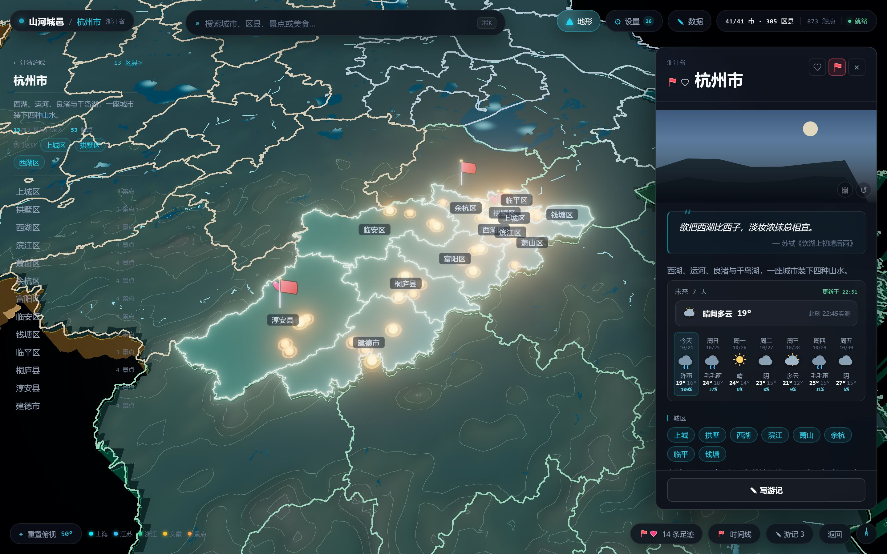

城市面板包含省份与城市名、封面图、诗句与简介、天气、下辖区县入口、城市美食、照片墙入口，底部常驻「✎ 写游记」。

2. **点区县**（面板里的区县、地图上的区县名、左侧索引、搜索结果都可以），打开区县详情：

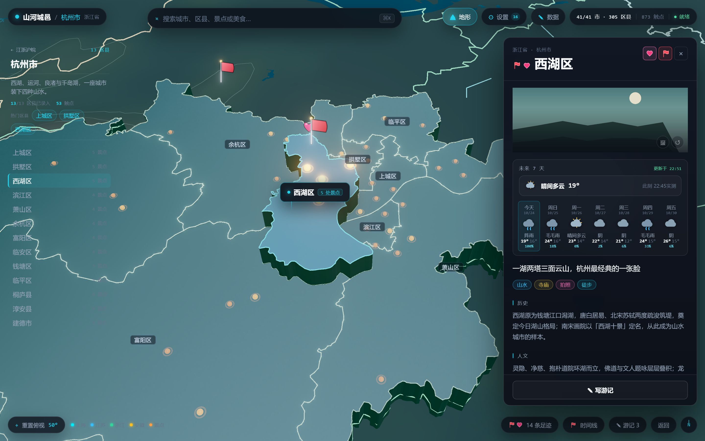

区县详情自上而下：名称与操作按钮、封面、天气、一句话印象、标签、历史、人文、名人、特色、景点、美食、特产与非遗、照片墙入口、游玩日期、底部「✎ 写游记」。

### 关闭与返回

- 面板右上角 **×**：只是收起面板，地图停留在当前城市，方便继续点别的区县。
- 底栏「返回」或 `Esc`：区县 → 城市 → 全省总览，逐层回退。
- 底栏指南针：不改变层级，只把镜头拉回当前层级的全景。

### 图层开关

顶栏「地形」按钮控制地形图层（山地、湖泊、江河的立体起伏与流动的水系）。
开关状态写在本地，下次打开应用还是上次的设置。天气图层在「设置 → 图层」里，同样会被记住。

---

## 四、搜索

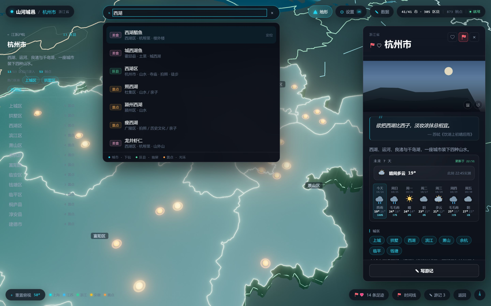

点顶栏搜索框或按 `Ctrl + K`（macOS 为 `Command + K`），输入关键词。

结果分四类，颜色不同：**城市**（进入城市）、**区县**（打开详情）、**景点**（地图上打光环）、**美食**（定位到所在区县）。
点击或回车跳转，`Esc` 关闭。搜过的词会留在面板里，下次直接点。

---

## 五、去过与收藏

### 标记

在城市面板或区县详情右上角：

- **⚑ 去过**：点亮后地图上插旗，同时自动记录一次到访时间
- **❤ 收藏**：放进想去清单，不影响足迹统计

名字旁边常驻显示这两个状态，不用打开面板也知道标过没有。

### 标记样式

「去过」的旗子有四种样式：**小旗子、图钉、打卡章、脚印**。

入口在底栏「足迹收藏」面板顶部（手机端也在这里，因为手机没有设置按钮）：

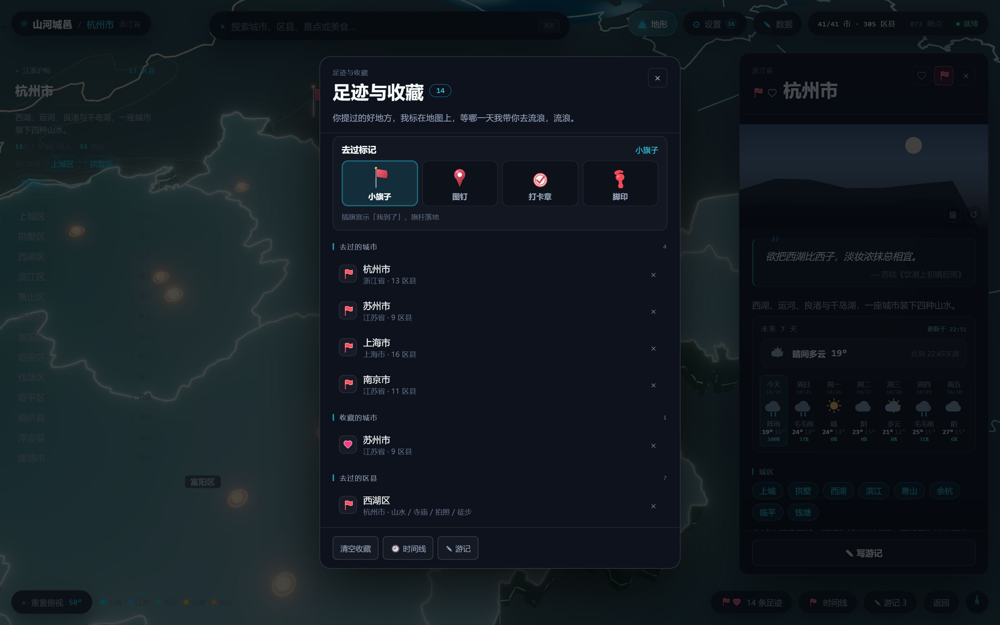

选中的样式会立刻应用到地图，并且记住，下次打开还是它。

### 足迹收藏面板

按省、市分组列出所有去过和收藏的地点，可以点进去、也可以就地取消标记。手机端这里还能改标记样式。

---

## 六、时间线

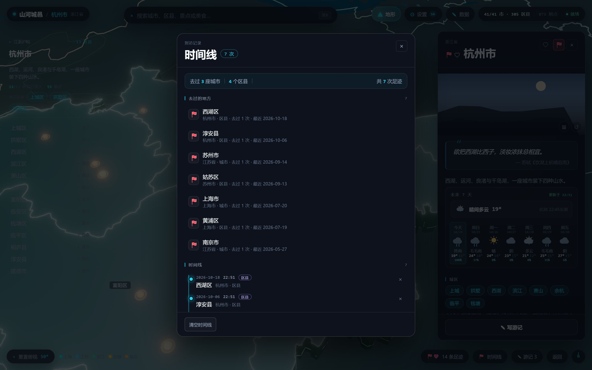

底栏「时间线」把所有到访记录按时间排成一条线，顶部汇总「去过几座城市、几个区县、共几次足迹」。

- 记录是自动的：点「去过」的那一刻就记一条。
- 想补录或修正具体日期，在区县详情的「游玩日期」里手动添加，支持起止范围。
- 「清空时间线」会删掉全部记录（点两下确认），但不会取消「去过」标记本身。

---

## 七、游记

### 新建与保存

在城市面板或区县详情的底部常驻条点「✎ 写游记」，自动关联到该城市 / 区县。

编辑器会自动保存，随时关掉都不会丢。标题留空时按「无题游记」处理。

### 列表与预览

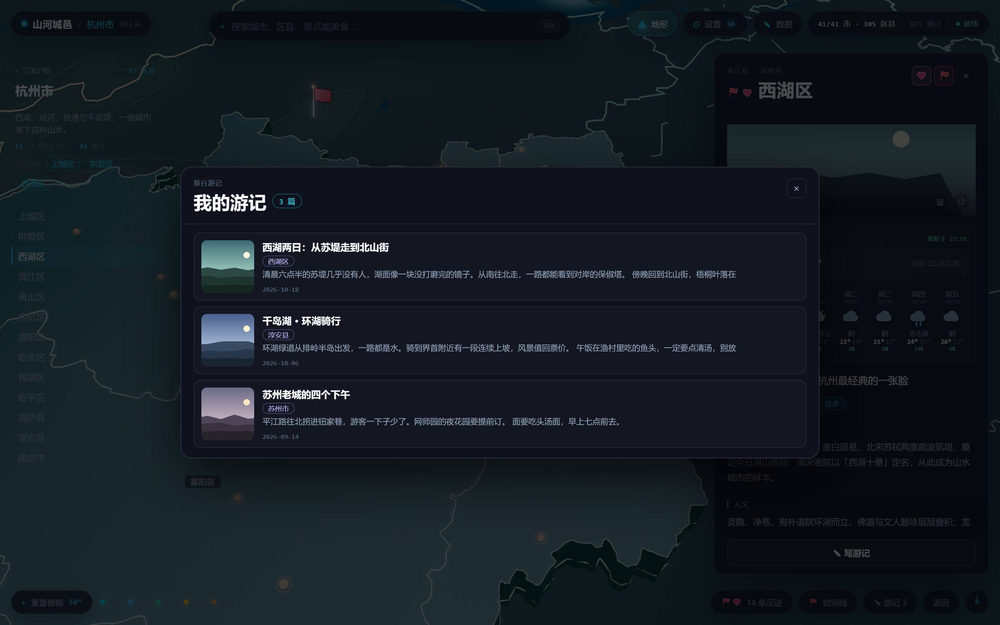

底栏「游记」打开全部游记。列表每篇的封面按这个顺序取：本篇第一张图 → 该地的自定义背景 → 该地照片库里的第一张照片 → 内容自带主图 → 渐变色块。

**点开一篇是预览，不是编辑**：先用只读方式看最终排版，要改再点右上角「编辑」。
右上角操作区固定是 `编辑` `删除` `×`，编辑态变成 `保存` `删除` `×`。

### 编辑器

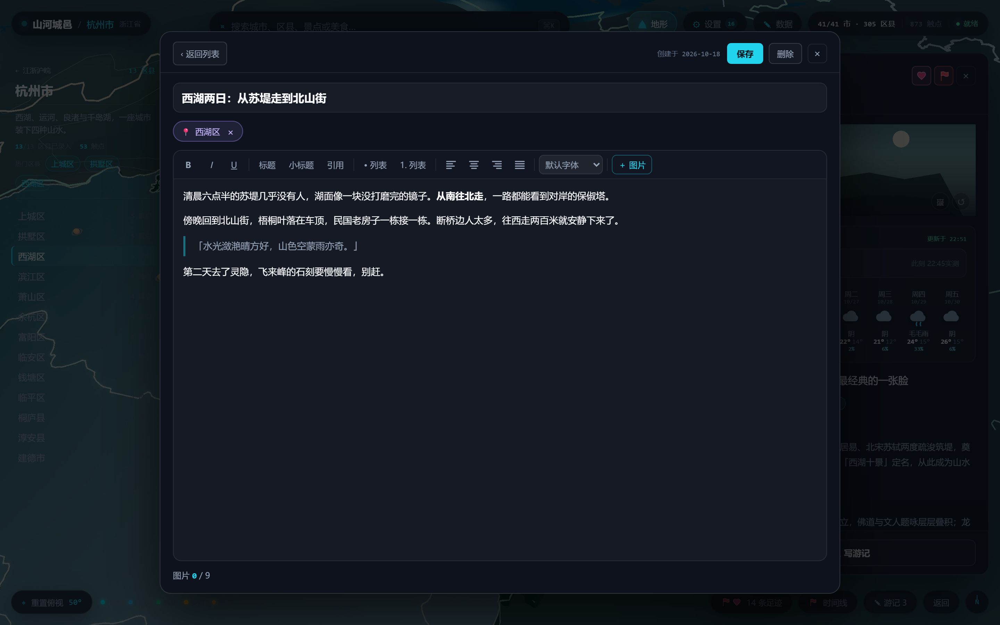

正文是所见即所得，写的时候就是最终排版。工具栏从左到右：

- **B / I / U**：加粗、斜体、下划线
- **标题 / 小标题**：把当前段落变成一级、二级标题（再点一次取消）
- **引用**：变成引用块
- **• 列表 / 1. 列表**：项目符号、编号列表
- **对齐**：左、居中、右、两端对齐；选中图片后点对齐，图片也跟着走
- **字体**：默认、宋体、黑体、微软雅黑、楷体、仿宋、隶书、幼圆，以及 Arial / Times New Roman / Georgia / Verdana / Courier New
- **＋ 图片**：从本地照片库挑（见 10.1），一篇最多 9 张

图片插在光标所在处，按原图尺寸插入（比正文宽才缩到正文宽），高度自动按比例。
**改大小**：点一下图片进入选中态，拖右下角圆形手柄左右移动；点图片右上角的 × 删掉它。

手机上键盘弹出时，整个编辑面板会被钉在可见区域内，工具栏不会被顶出屏幕——打字时也能随手切换字体和对齐。

### 删除

删除按钮在右上角，点第一下变红显示「确认删除」，再点一下才真删。删掉的游记和它带的图片一起清掉，不进回收站。

---

## 八、照片墙

### 四种展陈

桌面端右上角可切换：

| 样式 | 效果 |
| --- | --- |
| 展厅 | 网格挂画，带展签，默认样式 |
| 长廊 | 纵深走廊，两侧挂画，适合横屏照片 |
| 灯箱 | 单幅聚光，一张一张看 |
| 照片空间 | 所有照片悬浮成一条旋转的星河（见第九章） |

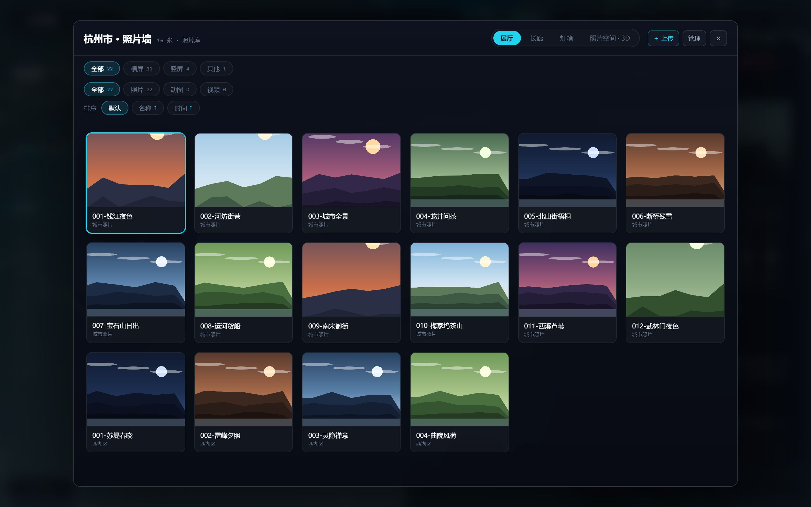

**手机端只有展厅、长廊、灯箱三种**，没有照片空间、没有排序条、也没有上传和管理——手机上的照片归系统相册管。

### 上传（桌面端）

点「+ 上传」，选图片或视频（jpg / png / webp / gif / mp4 / webm / mov），写入绑定目录下对应的「省 / 市 / 区县」文件夹并入库。

### 筛选、排序、管理（桌面端）

- **筛选**：按画幅（横屏 / 竖屏 / 其他）、按类型（照片 / 动图 / 视频）
- **排序**：默认、名称、时间，再点一次当前项切换升 / 降序
- **管理**：进入批量模式，多选后删除；删除是真实删除磁盘文件，需要二次确认

### 看图

点任意一张进入查看器：

| 操作 | 效果 |
| --- | --- |
| 滚轮 / 双指捏合 | 缩放（以指针位置为锚点） |
| 双击 | 在 1:1 和放大之间切换 |
| 放大后单指 / 拖动 | 平移查看细节 |
| 1:1 时单指拖动 | 图片固定不动 |
| 底部按钮 | 放大、缩小、左转、右转、复位 |
| `←` `→` | 上一张 / 下一张 |

**手机端左右滑动即可切换上一张、下一张**（滑过屏宽的 16% 就算一次），因此手机上没有左右箭头。
视频例外：进度条本身就是横向拖动，所以视频仍用两侧箭头切换。

---

## 九、照片空间（3D）

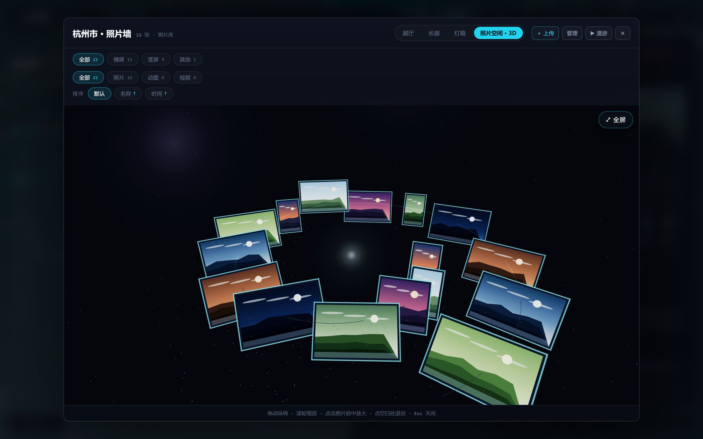

桌面端照片墙右上角切到「照片空间 · 3D」，所有照片飞进一条缓慢自转的旋臂星河，带相框与暖纸色描边。

| 操作 | 效果 |
| --- | --- |
| 拖动 | 环绕星河旋转 |
| 滚轮 | 拉近 / 拉远 |
| 点击照片 | 镜头飞抵到它面前 |
| 再点一次 | 放大查看（可缩放、旋转、平移） |
| `Esc` | 退出放大，再按一次退出照片空间 |

一次最多铺 200 张，超出的照片在展厅或长廊里看。

---

## 十、设置与内容编辑

### 10.1 照片库（桌面端）

顶栏「设置」→ 照片库：

- **选择文件夹**：绑定本地目录，例如 `D:\照片\旅行`。之后上传的照片都归档到该目录下的「省 / 市 / 区县」文件夹。
- **实时更新**：开启后每 20 秒重扫一次目录，新放进去的照片会自动出现在照片墙，带 LIVE 标记。
- **重新绑定**：随时换目录，绑定信息存在本机。

目录里的照片按「省 / 市 / 区县」的目录结构或文件名识别归属；识别不出的会归到根目录，不会丢。

### 10.2 数据面板：改内容

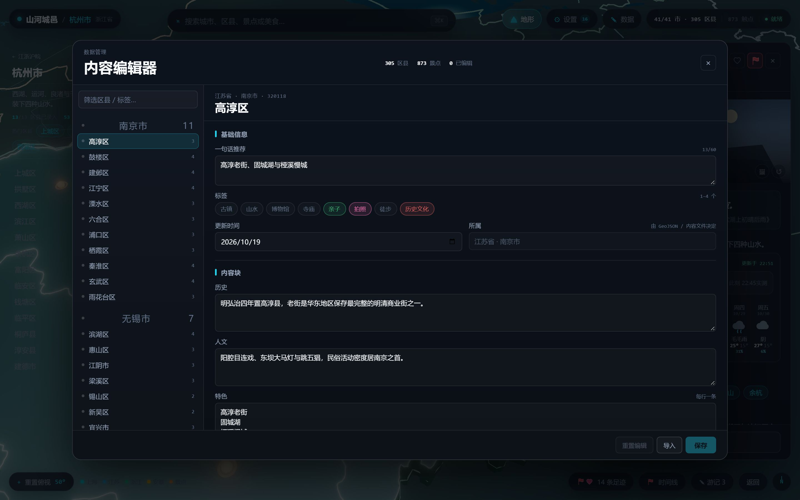

顶栏「数据」打开内容编辑器。左边（手机端是顶部下拉）是市 / 区县列表，带搜索框；右边是编辑区，可以改：

- 一句话印象、标签
- 历史、人文、名人、特色
- 景点、当地美食、特产与非遗

底部三个按钮：**重置编辑**（把当前编辑恢复成内置内容，点两下确认）、**导入**（读入一个 JSON）、**保存**（只写入改动过的部分）。
有内容不合格时右下角会显示「N 项待修正」，修好之前不能保存。

> 修改只存在本机，不会回写到仓库里的 JSON 文件。

---

## 十一、手机端

手机端与桌面端共用同一套数据和视觉，差异都在交互上。

### 11.1 半屏面板

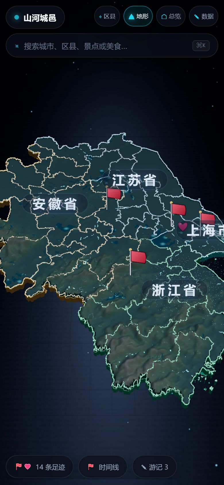

打开城市或区县时，面板默认占下半屏（约 60%），上半屏始终留着地图；选中的地点会自动框到上半屏，不会被面板挡住。

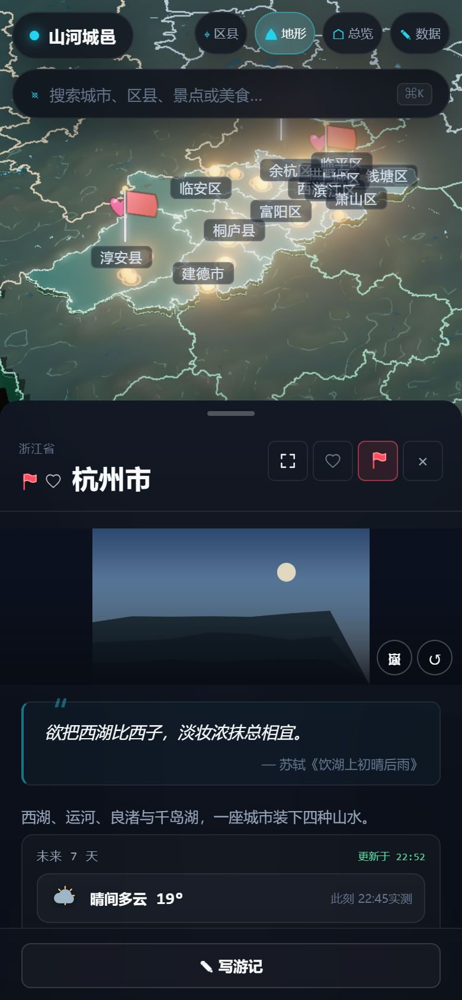

- **抓手**：面板顶部那条横线。点一下收起成一条，露出整张地图；再点一下展开。收起不会关闭面板，镜头也不跳。
- **全屏**：面板右上角的 ⛶ 铺满全屏，再点一次或按返回键回到半屏。

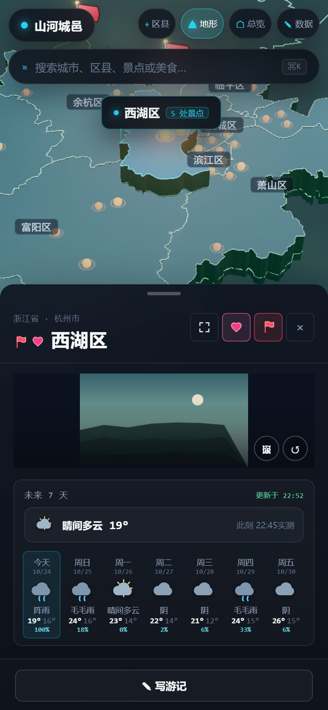

### 11.2 返回键

按手机返回键，按这个顺序退：

1. 全屏面板 → 半屏
2. 半屏面板 → 关闭
3. 搜索 / 选择器等浮层 → 关闭浮层
4. 城市层级 → 总览
5. 已在总览 → 第一次提示「再按一次退出」，2 秒内再按才退出应用

### 11.3 区县选择器

顶栏「区县」弹出全屏列表：搜索框 + 按城市分组的区县清单，点一下直达，不用在地图上找。

### 11.4 相册自动绑定

手机端不用导入照片，也不选目录，直接读系统相册：

- 相册叫什么，就归到哪个区县：相册「西湖区」→ 西湖区的照片墙
- 去掉「市 / 区 / 县」后缀也认：「淳安」等同「淳安县」；市名相册归到城市层级
- 授权一次长期有效，新拍的照片几秒后就进来；切回应用会自动重扫
- 改了相册名或新建同名相册后，点照片墙右上角「⟳ 刷新相册」立即重新识别

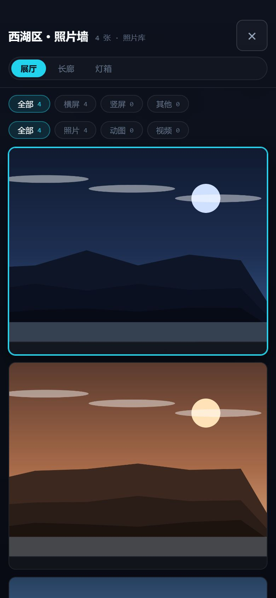

没授权或这个区县还没有照片时，照片墙里会有一张说明卡，告诉你该建一个什么名字的相册，并列出手机上已有的相册和张数。

### 11.5 手机端没有的东西

- 没有「设置」（照片库由系统相册取代）
- 没有「+ 上传」「管理」「排序」和「照片空间 · 3D」
- 数据面板与桌面端是同一个（顶栏「数据」进入），手机端列表改成顶部下拉

### 11.6 手机端游记

与桌面端完全一致，编辑器在手机上会钉在可见区域，键盘弹出不会把工具栏顶出屏幕。

---

## 十二、快捷键与手势

| 操作 | 桌面端 | 手机端 |
| --- | --- | --- |
| 旋转地图 | 左键拖动 | 单指拖动 |
| 缩放地图 | 滚轮 | 双指捏合 |
| 搜索 | `Ctrl / Command + K` | 顶栏搜索框 |
| 关闭面板 / 浮层 | `Esc` | 返回键 |
| 回到当前层级全景 | 底栏指南针、「重置俯视 50°」 | 顶栏「总览」 |
| 上一张 / 下一张照片 | `←` `→` | 左右滑动 |
| 照片放大 / 缩小 | 滚轮、双击 | 双指捏合、双击 |
| 面板全屏 | 不需要（右侧栏不挡地图） | 面板右上角 ⛶ |
| 退出应用 | 关闭窗口 | 总览下连按两次返回键 |

---

## 十三、常见问题

**数据会上传吗？**
不会。没有账号，也没有服务器，全部存在本机。

**双击 exe 没反应？**
应用已经在运行，单实例设计下第二次双击只会把窗口拉到前台。

**手机端照片墙是空的？**
依次确认：系统相册里有与区县同名的相册；已授予照片权限（设置 → 应用 → 权限 → 照片和视频）；相册里确实有照片。都满足后进入对应区县即可。改过相册名就点「⟳ 刷新相册」。

**两个区县同名，照片会串吗？**
先按区县名匹配，再按「市 + 区县名」补充；仍冲突时取第一个并在界面上标出来源。

**删除照片能恢复吗？**
不能。照片墙里的删除是删磁盘上的原文件，所以设了二次确认（按钮变红后再点一次）。

**3D 照片空间卡？**
减少这个地点的照片数量，或改用展厅 / 长廊。一次最多 200 张。

**改内容改错了怎么办？**
数据面板底部「重置编辑」恢复成内置内容（点两下确认）。已经保存过的修改也会一起清掉。

**外面阴天，地图上却在飘雨 / 雪？**
天气图层只看「此刻是否正在降水」，不是当天的天气概况。可以在城市 / 区县详情的天气卡顶部核对「此刻」实况；卡片右上角标「离线」说明读的是缓存。不想要这层可以在「设置 → 图层」关掉。

**游记里选了照片插不进去？**
入口是工具栏的「＋ 图片」，勾选后点「插入（N）」。桌面端需要先在「设置 → 照片库」绑好目录。

**换了电脑，数据怎么带过去？**
应用内没有一键同步。游记、足迹、收藏、照片索引存在应用本地存储里，换设备需要手工迁移；内容编辑可以逐个区县用「导入」读入 JSON。照片本身在你自己指定的目录里，拷过去重新绑定即可。

---

## 十四、数据存放位置

| 内容 | 位置 |
| --- | --- |
| 游记、足迹、收藏、标记样式、图层开关、内容修改 | 应用本地存储（localStorage） |
| 游记图片、自定义背景图、照片字节缓存 | 本机 IndexedDB |
| 照片与视频原文件 | 你自己绑定的目录（桌面）或系统相册（手机） |

卸载应用或清除应用数据会一起清掉本地记录，照片原文件不受影响。

---

**适用版本**：山河城邑 0.9.24（Windows x64 / Android arm64）
**数据范围**：上海市、江苏省、浙江省、安徽省，41 市 / 305 区县 / 873 个景点
**反馈**：GitHub 仓库 `wuyunjiegithub/shanhe-chengyi` 的 Issues
